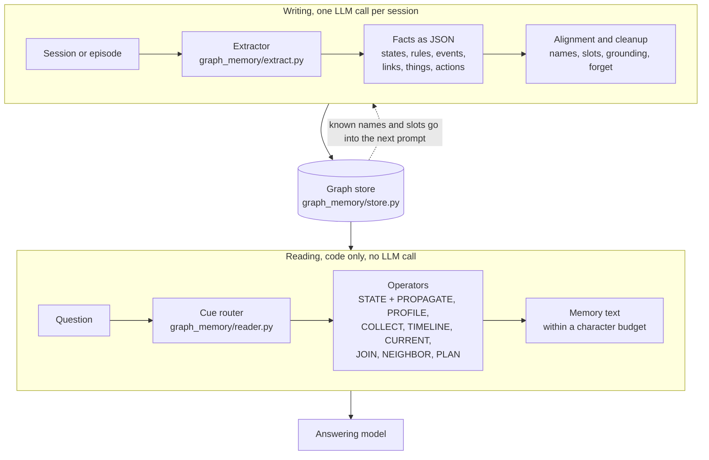
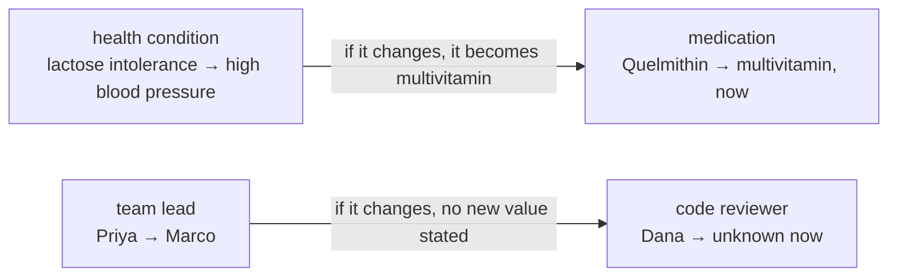
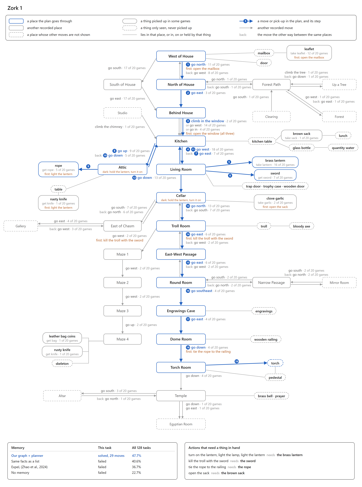
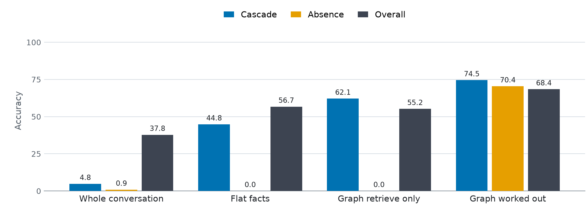
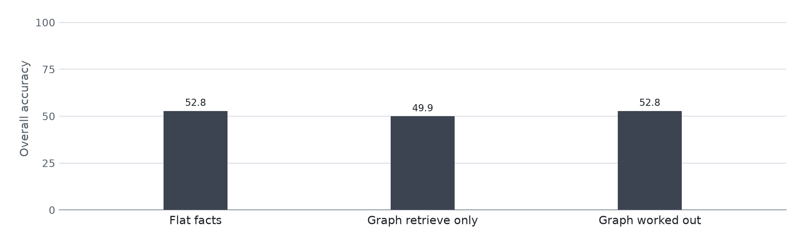
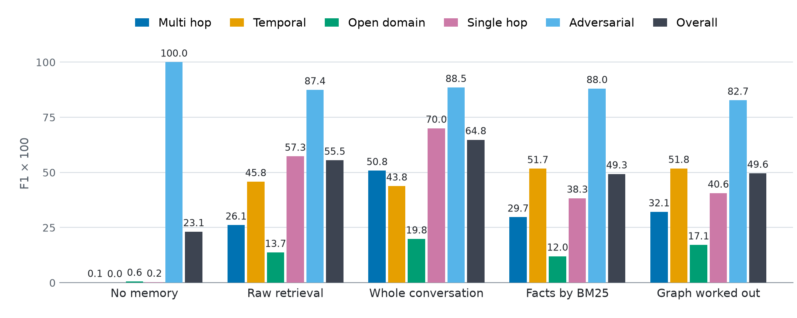
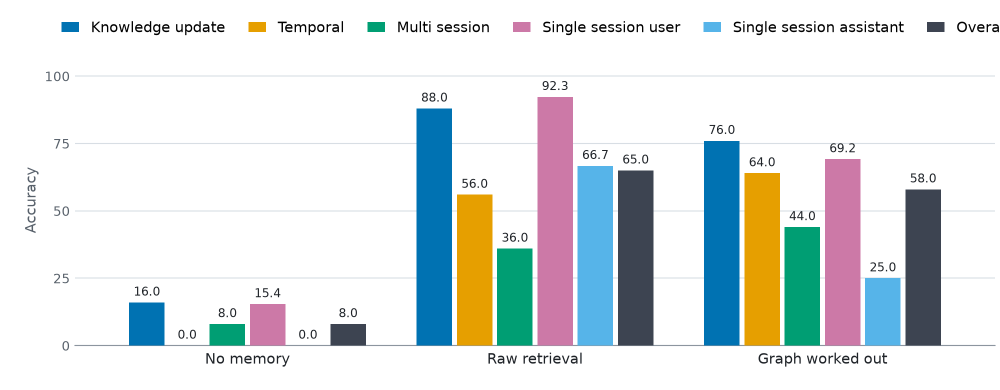
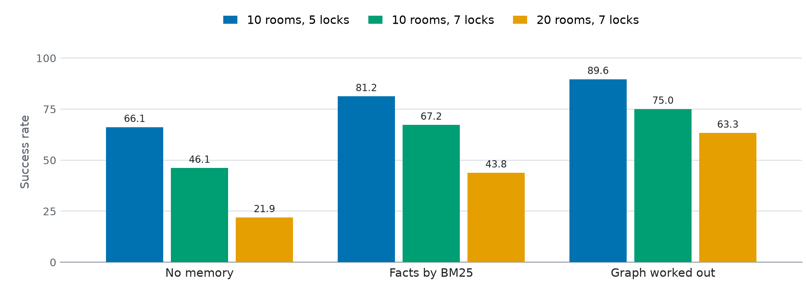

# Graph Memory

Graph Memory is a long-term memory system for LLM assistants and agents. A single model call per session extracts entities, dated facts, state slots and user-declared dependencies into a typed graph. I also designed a reader program that computes the memory text from the graph at answer time and hands it to the model. On questions that need computation over memory, including dependency propagation, temporal ordering and intervals, aggregation across sessions and route planning, this is stronger than giving the model the graph itself or using other memory methods. It scores highest among all compared methods on the dependency questions of MEME, the temporal questions of LoCoMo and LongMemEval, and the persistent house benchmark I built. It is also very economical with tokens. On the persistent house it uses about half the tokens of BM25 fact retrieval. On the other benchmarks it also uses fewer answering tokens than the other memory methods.

## Architecture



Below is what PROPAGATE produces from the dependencies in the examples.



| Part | Module | What it does |
|---|---|---|
| Extractor | `graph_memory/extract.py` | One LLM call per session or episode. Returns JSON facts grounded in specific turns. Known names and slots feed into the prompt to keep entity names consistent across sessions. |
| Store | `graph_memory/store.py` | Holds entities, dated events, state slots, and dependency rules. Slot values can be set, ended, or forgotten. For text environments it also stores links, items, actions, and entry conditions. |
| Reader | `graph_memory/reader.py` | Routes questions by cue words to deterministic operators and assembles the memory text within a character budget. |
| Planner | `graph_memory/plan.py` | Backward-chains over links, items, and conditions to find the steps required to obtain a target item. |
| Chat memory | `graph_memory/chat.py` | End-to-end pipeline for user-assistant conversations. Accepts sessions and returns memory text. |
| LLM client | `graph_memory/llm.py` | Async client for any OpenAI-compatible endpoint. Supports streaming, retries, and adaptive concurrency. |

| Operator | Used when | Output |
|---|---|---|
| STATE + PROPAGATE | the question targets a state slot | The current value. If a dependency changed, the stated replacement or "unknown now", with the full chain of changes. |
| PROFILE | the store has slots | All remaining slots, one line each. |
| COLLECT | *how many, which, list, all* | All matching records, grouped, deduplicated, counted, and sorted chronologically. |
| TIMELINE | *when, how long, before, after, ago* | Dated records in chronological order, with the interval between events. |
| CURRENT | *now, currently, latest* in a store without slots | The latest and earlier values, or the value at the date of a referenced event. |
| JOIN | *the X who / that ...* | Facts reachable from named entities, up to three hops. |
| NEIGHBOR | always, last | The most related remaining facts. |
| PLAN | text environments | An itinerary specifying what to acquire, which actions to take, and the route. |

`Reader(store, propagate=False)` reads the same graph but only retrieves. It presents records along dependency edges without computing conclusions. Comparing it with the full reader and with flat facts isolates the contribution of the operators from that of the extractor.

## Example graph



Part of a graph built from 20 games of the text adventure Zork 1 in earlier text game experiments. The scripts for those experiments are not included, but the graph itself is in `graphs/zork/zork1.json`. Here the records were read directly from the game engine. The extractor produces the same record types from game text. The blue route is the plan that PLAN computed for the task "get the torch", numbered by step.

## Install

```bash
cd graph-memory
pip install -e ".[dev]"
```

Requires Python 3.11 or newer. The only runtime dependency is `httpx`.

## Configure the model

Any OpenAI-compatible chat endpoint works. Configure it through environment variables or a `.env` file in the working directory. See `.env.example` for the format.

```bash
OPENAI_API_KEY=your-key
OPENAI_BASE_URL=https://your-endpoint/v1
GRAPH_MEMORY_MODEL=qwen3
```

## Quick start

```python
import asyncio
from graph_memory import ChatMemory, LLMClient, LLMConfig

async def main():
    cfg = LLMConfig(model="qwen3", enable_thinking=False, temperature=0.2)
    async with LLMClient(cfg) as llm:
        mem = ChatMemory(llm, cache=".graph_memory_cache")
        await mem.add_session([
            {"role": "user", "content": "I take Quelmithin for my lactose intolerance. "
                                        "If my health condition changes, my medication will be a multivitamin."},
            {"role": "assistant", "content": "Noted."}], "2024/03/01 (Fri) 10:00")
        await mem.add_session([
            {"role": "user", "content": "My doctor now says I have high blood pressure."},
            {"role": "assistant", "content": "Thanks for the update."}], "2024/03/09 (Sat) 09:30")
        print(mem.recall("What medication am I taking?"))

asyncio.run(main())
```

`enable_thinking=False` sends `chat_template_kwargs` to disable Qwen3 thinking on vLLM or SGLang. Set it to `None` for endpoints that do not accept this field. `mem.save(path)` and `ChatMemory.load(path)` persist a memory across runs.

| Example | Needs a model | Shows |
|---|---|---|
| `examples/offline_propagation.py` | no | Memory text with and without propagation, built from pre-extracted facts |
| `examples/plan_route.py` | no | An itinerary planned from two game episodes |
| `examples/quickstart.py` | yes | Full pipeline from extraction through memory text to answer |

Sample output of `python examples/offline_propagation.py` for one question.

```text
Q: Who is my code reviewer now?

worked out (G):
Current values, worked out from the records and the stated dependencies:
- the user's code reviewer: unknown now (no longer valid). It was Dana (2024-03-01). Why: the user's team lead
  changed on 2024-03-09 (Priya → Marco); the code reviewer depended on it and no new code reviewer was stated.

retrieved only (Gr):
Records and stated dependencies of the asked values:
- the user's code reviewer: Dana (2024-03-01). Stated: it depends on the user's team lead (Priya); if the team
  lead changes, the code reviewer would change too (new value not stated).
  the user's team lead: Priya (2024-03-01) → Marco (2024-03-09).
```

## Computed graphs

`graphs/` holds the graphs computed in the formal runs, built with the code in this package, and reading them needs no model. The memory text recomputed from the MEME and LoCoMo graphs matches the formal runs question by question. The three house files are the memories saved at the end of the formal runs. Planning again on the Zork graph gives the same route as the briefing recorded in that game.

| Folder | Contents | Files |
|---|---|---|
| `graphs/meme/` | One graph per conversation of the MEME formal split, up to the point where the questions after the change are asked | 90 |
| `graphs/locomo/` | One graph per long conversation of the LoCoMo formal split | 8 |
| `graphs/house/` | For each of the three house sizes, the memory after all batches, covering four houses | 3 |
| `graphs/zork/` | The Zork 1 graph behind the example figure, with 35 places, 58 moves and 40 things | 1 |

The STALE and LongMemEval graphs are not included. Each of them holds every fact from about 50 conversations and takes from about a hundred to several hundred KB, so the scripts below regenerate them when needed.

The code below loads one MEME graph and asks about the commute.

```python
import json
from graph_memory import Reader, Store

store = Store.from_json(json.load(open("graphs/meme/pl_047.json", encoding="utf-8")))
text, _ = Reader(store).brief("How long is my commute?", 6000)
print(text)
```

The output starts like this.

```text
Current values, worked out from the records and the stated dependencies:
- the user's commute mode: unknown now (no longer valid). It was bike (2023-03-17).
  Why: the user's employer changed on 2023/03/20 (Zypherix Labs → Dranthex Logistics);
  the user's office location depended on that, so it changed too (it becomes Quivira Springs);
  the commute mode depended on it and no new commute mode was stated.
- the user's commute duration: around 1.5 hours (now). It was about 1 hour (2023-03-17).
  Why: the user's employer changed on 2023/03/20 (Zypherix Labs → Dranthex Logistics);
  the user's office location depended on that, so it changed too (it becomes Quivira Springs);
  the user had said that if the office location changes, the commute duration becomes
  around 1.5 hours.
```

The LoCoMo graphs load the same way. The house memories load with `HouseMemory.load` from `graph_benchmarks/house_memory.py`. Given the Zork graph, `plan_brief` recomputes the route to the torch shown in the example figure.

## Reproduce the benchmark runs

The datasets are not included. Download each one into `data/`.

| Benchmark | File | Source |
|---|---|---|
| MEME | `data/meme/meme_filler32k.json` | Hugging Face `meme-benchmark/MEME` |
| STALE | `data/stale/T1_T2_400_FULL.json` | Hugging Face `STALEproj/STALE` |
| LoCoMo | `data/locomo/locomo10.json` | [snap-research/locomo](https://github.com/snap-research/locomo) |
| LongMemEval | `data/longmemeval/longmemeval_s_cleaned.json` | Hugging Face `xiaowu0162/longmemeval-cleaned` |

The persistent house tasks are generated by code and need no download.

Each benchmark runs in two steps. Extraction is resumable and cached by prompt and record. The answer step evaluates each memory arm.

```bash
python scripts/extract_meme.py --split formal
python scripts/run_meme.py --split formal --arms C,Fa,Gr,G

python scripts/extract_stale.py --split formal
python scripts/run_stale.py --split formal --arms G,Gr,Fa

python scripts/extract_locomo.py --split formal
python scripts/run_qa.py --bench locomo --split formal --arms N,R,C,F,G

python scripts/extract_longmemeval.py --split both
python scripts/run_qa.py --bench longmemeval --split formal --arms N,R,G

python scripts/make_house.py
python scripts/run_house.py --set h1 --arms N,F,G
python scripts/run_house.py --set b --arms N,F,G
python scripts/run_house.py --set l --arms N,F,G
```

Outputs go to `runs/<benchmark>/`. Each directory contains the extracted facts, one `answers.jsonl` per arm, and a score summary. For the house, `make_house.py` writes the three task sets to `data/house/` and `run_house.py` plays them batch by batch. It saves every episode, the memory before each batch and `summary.json`, and resumes where it stopped. `--set h1`, `b` and `l` run the three house sizes in the order of the results table.

| `--arms` | Arm | Memory given to the answering model |
|---|---|---|
| `G` | Graph worked out | The graph, computed by the reader |
| `Gr` | Graph retrieve only | The same graph, retrieve only |
| `Fa` | Flat facts | All extracted facts and rules as flat lines |
| `F` | Facts by BM25 | Facts ranked by BM25, within the budget |
| `T` | Model search | The model searches flat facts itself, up to three rounds. MEME only |
| `R` | Raw retrieval | BM25 over raw conversation chunks |
| `C` | Whole conversation | Every session in full |
| `N` | No memory | Nothing. LoCoMo, LongMemEval and the house only |

All runs shared these settings.
- **Temperature.** Answers use 0. Extraction uses 0.2. On MEME, STALE and LongMemEval a failed extraction is retried up to twice at 0.7. The house agent acts at 0.6.
- **Thinking.** Off for Qwen3 with `--thinking off`, which is the default. Use `--thinking default` for endpoints that do not accept `chat_template_kwargs`.
- **Judge.** MEME, STALE and LongMemEval are scored with their official judge prompts, and LoCoMo with the official F1. The judge model defaults to `--model` but can be overridden with `--judge-model`. The house counts completed tasks.
- **Splits.** Dev and formal splits are fixed by the SHA-256 of the item ids.
- **Memory budgets.** MEME 6,000 characters. STALE 18,000, with the profile section capped at 16,000. On STALE the graph arms do not use inferred rules. LoCoMo 4,000. LongMemEval 6,000.
- **House budgets.** An episode stops after 40 steps or 60 model calls, and after 50 steps or 75 calls in the large houses. Briefings are capped at 1,200 characters, or 1,600 in the large houses.

### Reference results

All runs called the model name qwen3 through an OpenAI-compatible endpoint, with thinking off. For every call, including extraction, answers, judging and the house agent, the endpoint reported the model as `Qwen/Qwen3.8-Flash-Next-FP8`. Each score comes from a single run.

**MEME.** Formal split with 90 episodes and 1,060 questions per arm. Cascade questions ask for a value that depends on another one. The user said what it becomes when the other value changes, and later that change happened. Absence questions follow the same pattern, but no new value was ever given, so the right answer is that the value is unknown now. Overall covers all six question types.

| Arm | Cascade | Absence | Overall |
|---|---|---|---|
| Whole conversation | 4.8 | 0.9 | 37.8 |
| Flat facts | 44.8 | 0.0 | 56.7 |
| Graph retrieve only | 62.1 | 0.0 | 55.2 |
| Graph worked out | 74.5 | 70.4 | 68.4 |



**STALE.** PROPAGATE requires explicitly recorded dependencies. In STALE the changes follow from common sense and are never stated. Both the graph and flat facts score 52.8 overall, and the graph with retrieval only scores 49.9.



**LoCoMo.** Formal split with 8 conversations and 1,557 questions. Scores are official F1 × 100. Without memory the model answers "not mentioned" to every question, which the adversarial category counts as correct.

| Arm | Multi hop | Temporal | Open domain | Single hop | Adversarial | Overall |
|---|---|---|---|---|---|---|
| No memory | 0.1 | 0.0 | 0.6 | 0.2 | 100.0 | 23.1 |
| Raw retrieval | 26.1 | 45.8 | 13.7 | 57.3 | 87.4 | 55.5 |
| Whole conversation | 50.8 | 43.8 | 19.8 | 70.0 | 88.5 | 64.8 |
| Facts by BM25 | 29.7 | 51.7 | 12.0 | 38.3 | 88.0 | 49.3 |
| Graph worked out | 32.1 | 51.8 | 17.1 | 40.6 | 82.7 | 49.6 |



**LongMemEval.** Formal sample of 100 questions with 25, 25, 25, 13, and 12 per type. Scores are judge-assessed accuracy. Facts by BM25 and the whole conversation were not evaluated.

| Arm | Knowledge update | Temporal | Multi session | Single session user | Single session assistant | Overall |
|---|---|---|---|---|---|---|
| No memory | 16.0 | 0.0 | 8.0 | 15.4 | 0.0 | 8.0 |
| Raw retrieval | 88.0 | 56.0 | 36.0 | 92.3 | 66.7 | 65.0 |
| Graph worked out | 76.0 | 64.0 | 44.0 | 69.2 | 25.0 | 58.0 |



On these two benchmarks the graph outperforms raw retrieval on temporal questions, on multi-hop questions in LoCoMo and on multi-session questions in LongMemEval. It falls behind on single-detail lookups, where extraction discards fine-grained wording, and scores lower overall.

**Persistent house.** A benchmark built for this project, in `graph_benchmarks/house.py`. An agent does many tasks in the same text house. Each task asks it to bring an object to a room or put it in a container. Some objects are behind locked doors or in locked containers, and some keys are behind other locks. A few objects move between task batches. After each batch, code turns the episodes of the agent without memory into facts, together with one retry of each task it failed. No model call is involved, and both memories hold exactly these facts. Facts by BM25 lists them. The graph computes an itinerary that names each key in the order needed, where it was last seen and the route. The agent can also query either memory with a tool. The first three batches only fill the memory, and scores are success rates on the later batches. The house reader is in `graph_benchmarks/house_memory.py`, and PLAN in `graph_memory/plan.py` is its general form.

Each house size has four houses. The large houses hold 100 objects and the others 40. The test tasks number 192, 128 and 128.

| Arm | 10 rooms, 5 locks | 10 rooms, 7 locks | 20 rooms, 7 locks |
|---|---|---|---|
| No memory | 66.1 | 46.1 | 21.9 |
| Facts by BM25 | 81.2 | 67.2 | 43.8 |
| Graph worked out | 89.6 | 75.0 | 63.3 |



Four findings stand out.
- **The gain is behind locks.** On tasks without a lock every arm completes 84 to 100 percent. Behind locks the graph leads facts by BM25 by 11 to 26 points.
- **The graph wins by putting the key chain together.** On 164 tasks behind locks, memory already knew where the target was, which key opens each lock on the way and where each key was. The graph completed all of them. Facts by BM25 completed 83.3, 81.5 and 51.0 percent across the three sizes, and in the large houses only 2 of the 16 such tasks that need two keys. Reading flat facts, the model has to rebuild the chain itself. It queried the memory two to five times as often, and it used up its model calls in 23 episodes behind locks. The graph never did.
- **Memory only helps with what it has seen.** On the other 100 tasks behind locks, part of the chain was missing from memory. No arm completed more than 4 of them.
- **The lead grows with the house, and the graph is cheaper.** In the large houses the graph completes 63.3 percent against 43.8. In the two smaller sizes the gap is about 8 points. The graph also used about half the tokens of facts by BM25, and fewer than no memory.

## Tests

```bash
pytest
```

All tests run offline.

## Layout

```text
graph_memory/     core library
  store.py        graph store and fact serialization
  extract.py      LLM extraction, name and slot alignment
  reader.py       question routing and operators
  plan.py         backward chaining planner for text environments
  chat.py         session input, memory text output
  llm.py          async OpenAI-compatible client
graph_benchmarks/ data loading, official prompts, scoring, adapters, the house environment
scripts/          runs for each benchmark
examples/         runnable examples
tests/            offline tests
graphs/           graphs computed in the formal runs
docs/             example graph and score charts
```

## Citations

The four public benchmarks used here come from these papers.

- **MEME.** Seokwon Jung, Alexander Rubinstein, Arnas Uselis, Sangdoo Yun, Seong Joon Oh. [MEME: Multi-entity & Evolving Memory Evaluation](https://arxiv.org/abs/2605.12477). arXiv 2605.12477, 2026.
- **STALE.** Hanxiang Chao, Yihan Bai, Rui Sheng, Tianle Li, Yushi Sun. [STALE: Can LLM Agents Know When Their Memories Are No Longer Valid?](https://arxiv.org/abs/2605.06527) arXiv 2605.06527, 2026.
- **LoCoMo.** Adyasha Maharana, Dong-Ho Lee, Sergey Tulyakov, Mohit Bansal, Francesco Barbieri, Yuwei Fang. [Evaluating Very Long-Term Conversational Memory of LLM Agents](https://arxiv.org/abs/2402.17753). ACL 2024.
- **LongMemEval.** Di Wu, Hongwei Wang, Wenhao Yu, Yuwei Zhang, Kai-Wei Chang, Dong Yu. [LongMemEval: Benchmarking Chat Assistants on Long-Term Interactive Memory](https://arxiv.org/abs/2410.10813). ICLR 2025.

## License

This repository is released under the MIT License. Copyright © 2026 Kaijun Hao. See `LICENSE` for the full text.

The datasets are not part of this repository and keep their own licenses. Two folders are built from them and follow the same terms.

- `graphs/meme/` comes from MEME and is under [CC BY 4.0](https://creativecommons.org/licenses/by/4.0/).
- `graphs/locomo/` comes from LoCoMo and is under [CC BY-NC 4.0](https://creativecommons.org/licenses/by-nc/4.0/), for noncommercial use only.

The answer and judge prompts in `graph_benchmarks/` come from the official code of [MEME](https://github.com/SeokwonJung-Jay/MEME-public), [STALE](https://github.com/icedreamc/STALE) and [LongMemEval](https://github.com/xiaowu0162/LongMemEval). All three are MIT licensed. `graphs/zork/` comes from Zork 1, which Microsoft released under MIT.
